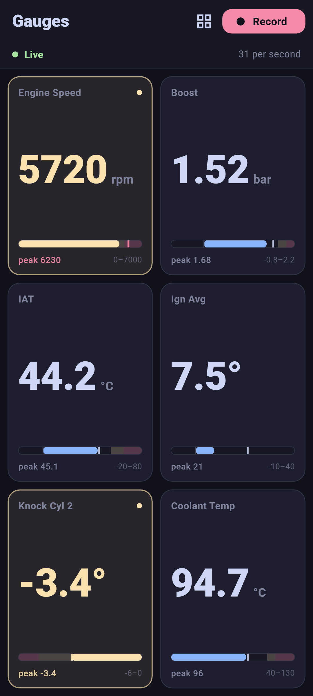

# PhantomLog

**The free Android companion app for the PhantomCAN dongle and the PhantomDASH display**, by Ghostwerks.

Log your engine and transmission, watch live gauges on your phone, look through your logs, and set up your PhantomDASH, all from one app. Tuned or stock, it works the same.

[Download](../../releases/latest) · [What it does](#what-it-does) · [What you need](#what-you-need) · [Install](#install) · [First log](#your-first-log) · [Good to know](#good-to-know) · [Credits and licences](#credits-and-licences)

## What it does

* **Logging.** Records the engine (ECU) and the transmission (TCU) together into one file, with **mode 22** (any car, stock or tuned) or **HSL** (faster; needs a tune with the HSL patch). The app reads the ECU and gearbox codes (tuned ECUs included) and picks the matching list for your car: HSL when your software has one, otherwise mode 22. If the car turns HSL down, the app switches to mode 22 by itself.
* **Up to 25 rows a second.** Engine and transmission are read side by side, so a slow gearbox does not hold the engine back.
* **Live gauges.** Big, readable gauges with peaks and warning ranges, for when you don't have a PhantomDASH. Choose 4, 6 or 8 and what each one shows; the app keeps them for your car. Pick your turbo (IS20 or IS38, or automatic) on the home screen for the turbo speed warning.
* **Log viewer.** Charts, split view, scatter, heatmap and a road dyno, right on the phone, in metric or imperial.
* **Analyze.** Every full-throttle pull side by side: peak power, torque and boost (averaged, so one spike doesn't set the number), the worst knock and its cylinder, lambda against target, fuel pressure against setpoint, and 0–60, 40–80 and 60–100 mph times. The strongest pull is starred. Share it as a picture or copy it as text.
* **Compare.** Lay a second log over the first, lined up at their first pull, to see what a change did.
* **Notes.** Add a note to any log (fuel, parts, weather) so you know what changed between two logs.
* **Your files, your way.** Logs are CSV files in the same layout as Simos.app logs, so the tools you already use open them. Share them straight from the app, or open logs from Simos.app, Simos Tools or your PC with **Open file**.
* **Remembers your setup.** The app reconnects to your dongle and picks the lists and gauges you chose for your car the last time.
* **PhantomDASH settings.** Opens the dash's own settings page inside the app and joins the dash's Wi-Fi by itself (scan the dash's code once).

PhantomLog **only reads**: it never flashes or tunes your car. For flashing and tuning, use Simos.app with your PhantomCAN.

## What you need

* An **Android phone**, Android 8 or newer, 64-bit (almost every phone from the last several years). The PhantomDASH page needs Android 10 or newer.
* A **PhantomCAN** dongle in Simos mode.
* A car the PhantomCAN supports (see the PhantomCAN instructions).
* iPhone: not yet.

## Install

1. On your phone, open the [latest release](../../releases/latest) and download **PhantomLog-1.0.1.apk**.
2. Open the file. Android asks to allow installs from this source the first time: allow it, then tap **Install**.
3. Open PhantomLog and allow **Nearby devices** (Bluetooth) when asked.

To check the download, compare its SHA-256 with the one in `SHA256SUMS` on the release page.

## Your first log

1. Plug in the PhantomCAN and switch the ignition on. Close Simos.app or any other app using the dongle: only one app can use it at a time.
2. In PhantomLog, tap **Find my dongle** and pick it within its one-minute Bluetooth window (the dongle's screen shows the countdown; hold **KEY** for 2 seconds to open it again).
3. The app reads your car's codes. Under **What to log**, pick the engine and transmission lists (Mode 22 or HSL).
4. Tap **Record** to log, or **Gauges** to watch live. Tap **Stop** when you are done; the log appears under **Recent logs**.

## Good to know

* **One app at a time.** While PhantomLog is connected, the PhantomDASH pauses and shows **APP CONNECTED**, and Simos.app can't connect.
* **Haldex** can be logged on its own, not together with the engine or transmission.
* **Your logs stay on your phone.** The app uses the internet only to check for firmware updates.
* **Dash settings only while parked.** Joining the dash's Wi-Fi can interrupt wireless Android Auto or CarPlay for a moment, and the dash refuses changes above 10 mph.
* **Safety.** Don't operate the app while driving. Set it up before you go, or let a passenger handle it.
* Modifying a vehicle's emissions equipment or its emissions-related software can be illegal for road use where you live. PhantomLog only shows and records what a control unit reports; you are responsible for complying with local law.

## Credits and licences

PhantomLog is made by Ghostwerks and is free to use. It is provided as a ready-to-install app on the [Releases](../../releases) page.

Volkswagen, Audi, Android, Bluetooth and the other names used here belong to their owners. This app is not affiliated with or endorsed by them. PhantomLog, PhantomCAN, PhantomDASH and Ghostwerks are names of these products and their maker. Simos.app and Simos Tools are separate products by their own developers. PhantomLog is built to be used alongside Simos.app and opens logs from both; it is not made, sponsored, endorsed or supported by their developers.

PhantomLog is built with [Flutter](https://flutter.dev) and these open-source packages, used under their licences:

* flutter_reactive_ble and reactive_ble_mobile by Signify Holding (BSD licence)
* mobile_scanner by Julian Steenbakker (BSD 3-Clause), using Google ML Kit for reading codes
* webview_flutter, webview_flutter_android, path_provider and material_ui by the Flutter Authors (BSD 3-Clause)
* share_plus by the Flutter project authors (BSD 3-Clause)
* permission_handler by Baseflow (MIT)
* cryptography (Apache 2.0)
* cupertino_icons by Vladimir Kharlampidi (MIT)

The full licence texts and notices of Flutter, its engine and every package in the app are in [THIRD_PARTY_NOTICES.txt](THIRD_PARTY_NOTICES.txt).
